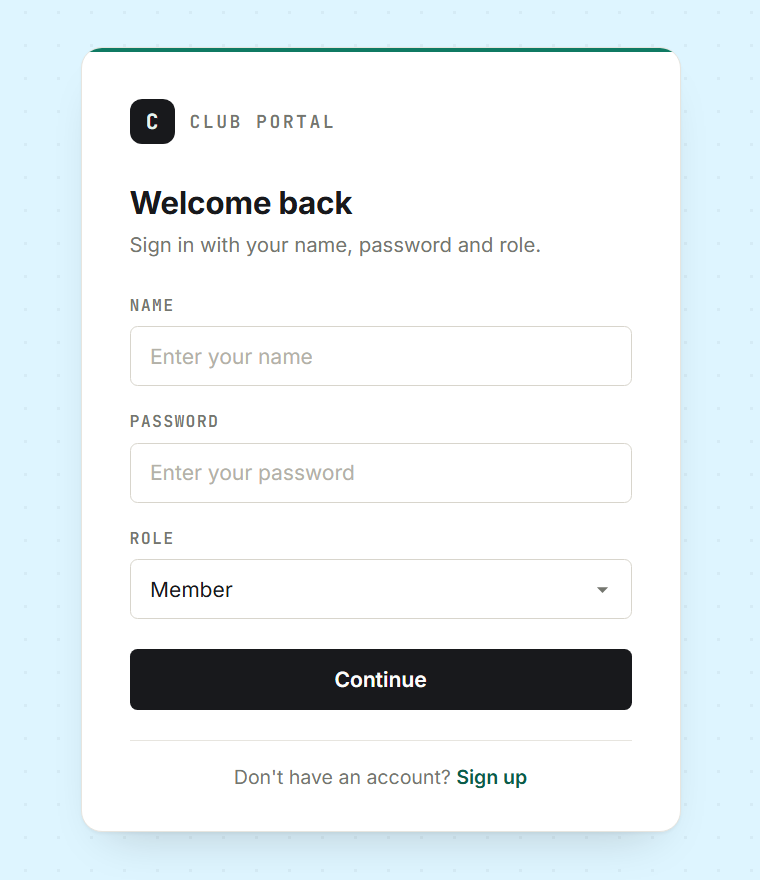
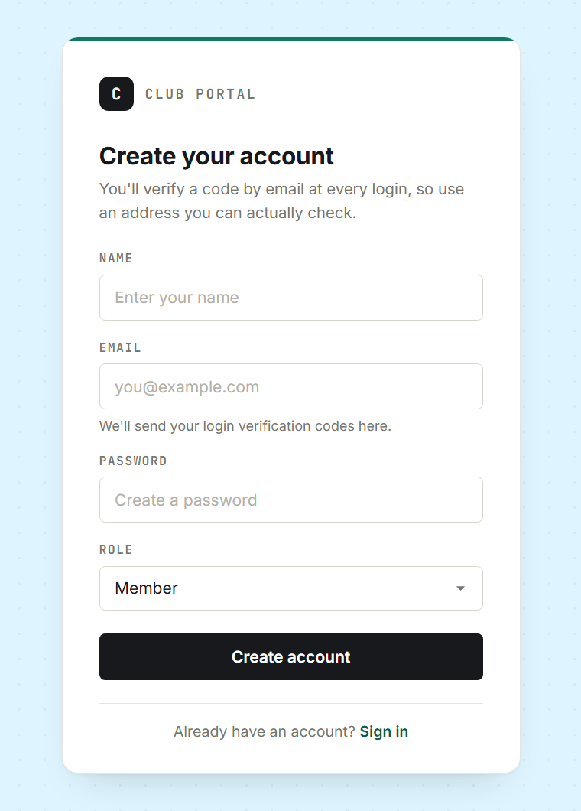
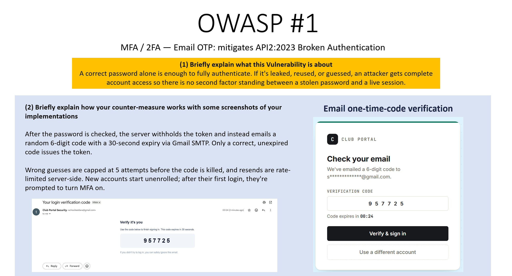
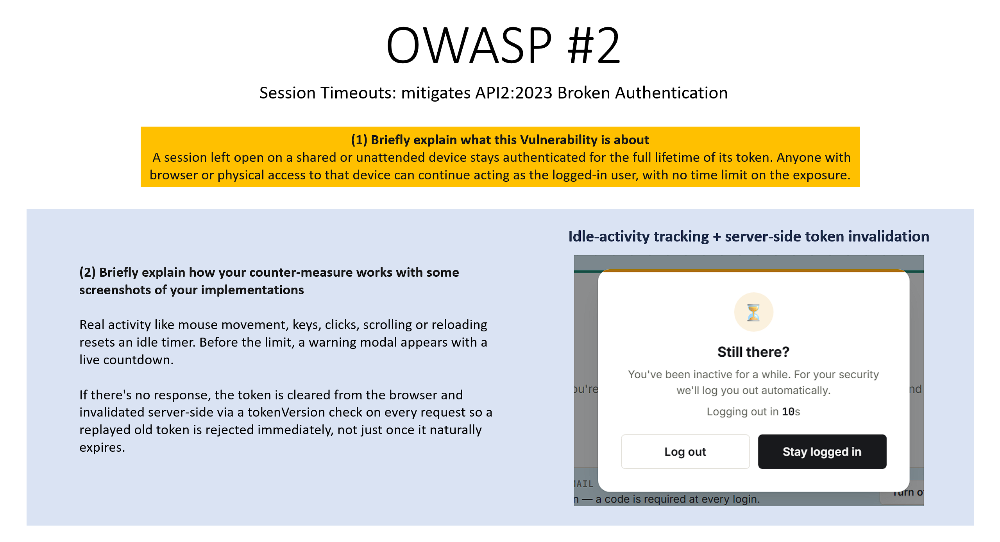

# Club Portal — Secure Auth (Email OTP MFA + Session Timeouts)

A small Node.js / Express / MongoDB club membership app with role-based access
(Member, President, Secretary), built as an OWASP API Security coursework
project. Two security measures from the OWASP API Security Top 10 have been
implemented end-to-end, front and back: **Multi-Factor Authentication (Email
OTP)** and **Session Timeouts**.

## Tech stack

- **Backend:** Node.js, Express, Mongoose (MongoDB Atlas)
- **Auth:** JWT (Bearer token), bcrypt password hashing
- **Email:** Nodemailer via Gmail SMTP
- **Frontend:** Plain HTML/CSS/JS (no framework), served statically by Express

## Features

- Registration and login for three roles: Member, President, Secretary
- Role-based protected routes (`/member-protected`, `/president-protected`, `/secretary-protected`)
- **MFA / 2FA (Email OTP)** — mitigates OWASP **API2:2023 Broken Authentication**
- **Session Timeouts** — mitigates OWASP **API2:2023 Broken Authentication**

---

## Preview

The app uses a minimal design system shared across every page: a warm dotted
background, a single teal accent, monospace labels, and consistent cards and
modals for both security measures.

<table>
  <tr>
    <td align="center"><b>Sign in</b></td>
    <td align="center"><b>Create account</b></td>
  </tr>
  <tr>
    <td></td>
    <td></td>
  </tr>
</table>

Registration asks for an email address because that's where the login
verification codes are sent.

---

## 1. MFA / 2FA — Email OTP

**Problem it fixes:** a correct password alone is enough to fully authenticate.
If it's leaked, reused, or guessed, an attacker gets complete account access —
there's no second factor standing between a stolen password and a live session.



*Summary of the vulnerability and the countermeasure, with the "Check your
email" verification screen and the one-time-code email a user receives.*

**How it works:**

1. On a correct password, the server does **not** issue a token yet. It
   generates a random 6-digit code, stores it against the account with a
   30-second expiry, and emails it via Gmail SMTP.
2. A JWT is only issued once the correct, unexpired code is submitted to the
   verify endpoint.
3. The code is **single-use** — it's deleted from the database the moment it's
   successfully verified.
4. Wrong guesses are capped at 5 attempts before the code is killed outright,
   forcing a resend (rate-limited verify step).
5. "Resend code" is throttled server-side (20s cooldown per account) so it
   can't be spammed.
6. **Enrolment:** new accounts start without MFA. The first login succeeds
   normally and prompts the user to turn email verification on. From the next
   login onward, the OTP step is mandatory. Users can turn it on/off anytime
   from their dashboard.

**Key files:**

| File | What's there |
|---|---|
| `Controller/authFunctions.js` | `memberLogin`, `verifyMfaCode`, `resendMfaCode`, `enrolMfa`, `getMfaStatus`, `disableMfa` |
| `Controller/mailer.js` | Nodemailer transport + the OTP email template |
| `Database/member.js` | `mfaEnrolled`, `mfaCode`, `mfaCodeExpires`, `mfaLastSentAt`, `mfaAttempts` fields |
| `public/login.html` | Two-step login UI (password → code) with live expiry/resend countdowns |
| `public/js/mfa-enrol.js` | Dashboard enrolment prompt + on/off toggle |

**Tunable constants** (`Controller/authFunctions.js`, top of file):

```js
const MFA_CODE_TTL_SECONDS = 30;          // how long a code stays valid
const MFA_RESEND_COOLDOWN_SECONDS = 20;   // minimum gap between resend clicks
const MFA_MAX_ATTEMPTS = 5;               // wrong guesses allowed before a code is killed
```

---

## 2. Session Timeouts

**Problem it fixes:** a session left open on a shared or unattended device
stays authenticated for the full lifetime of its token — anyone with
browser or physical access can keep acting as that user indefinitely.



*Summary of the vulnerability and the countermeasure, with the "Still there?"
warning modal that appears before an idle session is logged out.*

**How it works:**

1. Every protected page tracks real user activity (mouse movement, key
   presses, clicks, scrolling, touch) — not just page load.
2. After a period of inactivity, a "Still there?" modal appears with a live
   countdown. Genuine activity resets the timer; the modal is dismissed with
   "Stay logged in."
3. If there's no response (or "Log out" is clicked), the token is removed
   from the browser **and** invalidated server-side, by incrementing a
   `tokenVersion` field on the account.
4. Every authenticated request re-checks `tokenVersion` against the database.
   A copied or replayed old token is rejected immediately — not just once its
   JWT naturally expires days later.
5. Logging out in one tab broadcasts to other open tabs of the same account
   via a `storage` event, so they log out together.
6. Navigating back to a protected page after logout (browser Back button)
   doesn't show a stale cached page — the page is hidden until a fresh
   session check completes, and `pageshow`/bfcache restores force a reload.

**Key files:**

| File | What's there |
|---|---|
| `Controller/authFunctions.js` | `memberAuth` (checks `tokenVersion` on every request), `invalidateSession` |
| `Database/member.js` | `tokenVersion` field |
| `public/js/session.js` | Idle detection, warning modal, cross-tab logout, bfcache handling |
| `public/member.html` / `president.html` / `secretary.html` | Protected pages that load `session.js` |

**Tunable constants** (`public/js/session.js`, top of file):

```js
const IDLE_LIMIT_MS = 60 * 1000;   // total idle time allowed before logout
const WARNING_MS = 20 * 1000;      // warning shown this long before logout
```

> These are set short for demo purposes. For real use, raise them (e.g. 15
> minutes idle / 1 minute warning).

---

## Project structure

```
├── Controller/
│   ├── authFunctions.js   # auth, MFA, session-timeout logic
│   └── mailer.js          # Nodemailer OTP email sender
├── Database/
│   └── member.js          # Mongoose schema
├── routes/
│   └── userRouter.js      # all API routes
├── public/                # static frontend
│   ├── css/style.css
│   ├── js/session.js      # session timeout
│   ├── js/mfa-enrol.js    # MFA enrol/disable UI
│   ├── login.html
│   ├── register.html
│   ├── member.html
│   ├── president.html
│   └── secretary.html
├── docs/
│   └── images/            # screenshots used in this README
├── server.js
└── .env                   # not committed — see below
```

---

## Setup

### 1. Install dependencies

```bash
npm install
```

### 2. Configure environment variables

Create a `.env` file in the project root:

```env
PORT=5000
DB_CONNECT=<your MongoDB connection string>
APP_SECRET=<a long random string for signing JWTs>

# MFA / 2FA (Email OTP) — Gmail SMTP
EMAIL_USER=<your Gmail address>
EMAIL_PASS=<a 16-character Gmail App Password>
```

To create a Gmail App Password: turn on 2-Step Verification on the Gmail
account (Google Account → Security), then generate one at
[myaccount.google.com/apppasswords](https://myaccount.google.com/apppasswords).
Use the 16-character code (no spaces) as `EMAIL_PASS` — **not** the normal
Gmail password.

> **Do not commit `.env`.** Add it to `.gitignore` before pushing to GitHub —
> it contains live database and email credentials.

### 3. Run the server

```bash
node server.js
```

Then open `http://localhost:5000/register.html` to create an account.

---

## API reference

| Method | Route | Auth required | Purpose |
|---|---|---|---|
| POST | `/register-member` `/register-president` `/register-secretary` | No | Create an account for that role |
| POST | `/login-member` `/login-president` `/login-secretary` | No | Step 1 of login (password) |
| POST | `/verify-mfa-member` `/verify-mfa-president` `/verify-mfa-secretary` | No | Step 2 of login (OTP) — issues the JWT |
| POST | `/resend-mfa-member` `/resend-mfa-president` `/resend-mfa-secretary` | No | Re-sends the OTP for a login in progress |
| POST | `/enrol-mfa` | Yes | Turn MFA on for the current account |
| POST | `/disable-mfa` | Yes | Turn MFA off for the current account |
| GET | `/mfa-status` | Yes | Check whether the current account has MFA on |
| POST | `/logout` | Yes | Invalidate the current session server-side |
| GET | `/member-protected` `/president-protected` `/secretary-protected` | Yes (role-checked) | Example protected resource per role |

---

## Known limitations / design notes

- MFA is opt-in after the first login rather than mandatory from account
  creation — a deliberate design choice, not an oversight.
- `tokenVersion` invalidation is all-or-nothing per account: logging out
  invalidates every active session for that user across all devices, not
  just the current one.
- There's no rate limiting on the initial password-login endpoint itself
  (only on the MFA verify/resend steps) — Account Lockout / Rate Limiting on
  `/login-*` was out of scope for this submission's two chosen measures.
