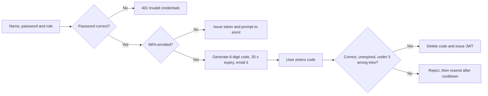
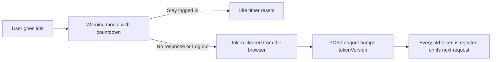
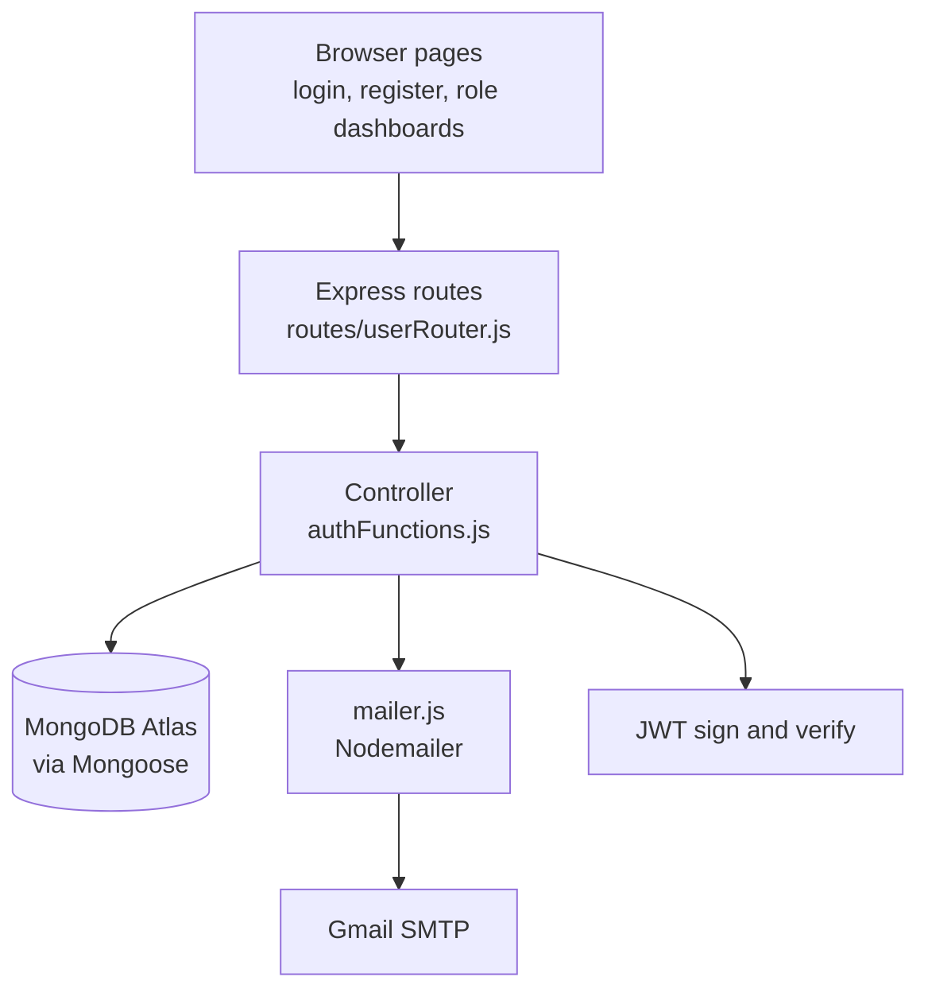

<div align="center">

# Club Portal

**Secure role-based sign-in for a club membership app.**<br/>
Email one-time-code MFA and idle session timeouts, built end to end across the Express API and the browser UI.


<br/>

<table>
  <tr>
    <td align="center" valign="top"><br/><sub><b>Sign in</b></sub></td>
    <td align="center" valign="top"><br/><sub><b>Create account</b></sub></td>
  </tr>
</table>

</div>

<br/>

## Contents

- [Overview](#overview)
- [Features at a glance](#features-at-a-glance)
- [Measure 1: MFA / 2FA with Email OTP](#measure-1-mfa--2fa-with-email-otp)
- [Measure 2: Session Timeouts](#measure-2-session-timeouts)
- [Architecture](#architecture)
- [Getting started](#getting-started)
- [API reference](#api-reference)
- [Notes and limitations](#notes-and-limitations)

## Overview

Club Portal is a small membership app with three roles: **Member**, **President** and **Secretary**. Each role signs in through its own route and lands on its own protected page.

It is an Application Security coursework project (Part 5, final submission). Two security measures from the OWASP API Security Top 10 are implemented across the backend and the frontend, and both mitigate **API2:2023 Broken Authentication**:

1. **MFA / 2FA (Email OTP)**: a correct password alone never gets you a token.
2. **Session Timeouts**: an abandoned session is logged out and its token is killed on the server.

> [!NOTE]
> The OTP expiry (30 s) and the idle timer (20 s idle, 12 s warning) are deliberately short so both measures can be demonstrated live. Both are one-line constants, listed under each measure below.

## Features at a glance

| Area | What it does |
|---|---|
| **Accounts and roles** | Register and sign in as Member, President or Secretary, with bcrypt-hashed passwords and role-checked protected routes |
| **MFA (Email OTP)** | Random 6-digit code emailed through Gmail SMTP, 30 s expiry, single use, issued only after the password step passes |
| **Brute-force protection** | Wrong codes are capped at 5 attempts, and "Resend code" has a 20 s server-enforced cooldown |
| **MFA enrolment** | Opt in after the first login, and turn it on or off at any time from the dashboard |
| **Session timeouts** | Idle detection on real activity, a "Still there?" warning with a live countdown, automatic logout |
| **Server-side invalidation** | Logout bumps a `tokenVersion`, so copied or replayed tokens are rejected immediately |
| **Safe back-navigation** | Pressing Back after logout never shows a stale dashboard, and all open tabs log out together |

## Measure 1: MFA / 2FA with Email OTP

<div align="center">

<br/><sub>The vulnerability, the countermeasure, the "Check your email" screen and the code email a user receives.</sub>
</div>

<br/>

**The problem:** a correct password alone is enough to fully authenticate. If it is leaked, reused or guessed, an attacker gets complete account access, with no second factor between a stolen password and a live session.



- After the password check the server **withholds the token**. It generates a random 6-digit code, stores it on the account with a 30-second expiry, and emails it through Gmail SMTP.
- A JWT is issued only when the correct, unexpired code reaches the verify endpoint.
- The code is **single use**: it is deleted from the database the moment it verifies.
- **Wrong guesses are capped at 5.** On the fifth the code is killed outright and the user must request a new one. Each wrong try reports how many attempts are left.
- **Resend is throttled on the server.** The 20-second cooldown is checked against `mfaLastSentAt` in the database, so disabling the button in the browser does not bypass it.
- **Enrolment:** a new account starts without MFA. The first login works normally and prompts the user to turn email verification on. From the next login the code step is mandatory. It can be switched off or on again from the dashboard.

**Tunable constants** (`Controller/authFunctions.js`, top of file):

```js
const MFA_CODE_TTL_SECONDS = 30;          // how long a code stays valid
const MFA_RESEND_COOLDOWN_SECONDS = 20;   // minimum gap between resend clicks
const MFA_MAX_ATTEMPTS = 5;               // wrong guesses allowed before a code is killed
```

**Where it lives**

| File | What is there |
|---|---|
| `Controller/authFunctions.js` | `memberLogin`, `verifyMfaCode`, `resendMfaCode`, `enrolMfa`, `getMfaStatus`, `disableMfa` |
| `Controller/mailer.js` | Nodemailer transport and the OTP email template |
| `Database/member.js` | `mfaEnrolled`, `mfaCode`, `mfaCodeExpires`, `mfaLastSentAt`, `mfaAttempts` |
| `public/login.html` | Two-step login with live expiry and resend countdowns |
| `public/js/mfa-enrol.js` | Dashboard enrolment prompt and on/off toggle |

## Measure 2: Session Timeouts

<div align="center">

<br/><sub>The vulnerability, the countermeasure and the "Still there?" warning shown before an idle session is logged out.</sub>
</div>

<br/>

**The problem:** a session left open on a shared or unattended device stays authenticated for the full lifetime of its token. Anyone with browser or physical access can keep acting as that user indefinitely.



- Each protected page watches **real activity**: mouse movement, key presses, clicks, scrolling and touch. Any of these resets the idle timer, and loading or reloading a page starts a fresh timer.
- Shortly before the limit a **"Still there?" modal** appears with a live countdown. "Stay logged in" resets the timer.
- With no response, or on "Log out", the token is removed from the browser **and invalidated on the server** by incrementing `tokenVersion` on the account.
- `memberAuth` compares the token's `tokenVersion` with the database on **every authenticated request**. A copied or replayed old token is rejected immediately, not days later when the JWT would have expired.
- Logging out in one tab signals the other open tabs through a `storage` event, so they all log out together.
- Pressing **Back** after logout does not reveal a cached dashboard: protected pages stay hidden until a fresh session check passes, and any page restored from the back-forward cache is reloaded.

**Tunable constants** (`public/js/session.js`, top of file):

```js
const IDLE_LIMIT_MS = 20 * 1000;   // total idle time allowed before logout
const WARNING_MS = 12 * 1000;      // warning appears this long before logout
```

> [!TIP]
> These are set short for demos. For real use, raise them, for example 15 minutes idle with a 1 minute warning.

**Where it lives**

| File | What is there |
|---|---|
| `Controller/authFunctions.js` | `memberAuth` (checks `tokenVersion` on every request) and `invalidateSession` |
| `Database/member.js` | `tokenVersion` |
| `public/js/session.js` | Idle detection, warning modal, cross-tab logout, back-forward cache handling |
| `public/member.html`, `president.html`, `secretary.html` | Protected pages that load `session.js` |

## Architecture



Pages never touch the database. They call the API, and the controller does the checks, talks to MongoDB and sends the email.

<details>
<summary><b>Project structure</b></summary>

```text
├── Controller/
│   ├── authFunctions.js   # auth, MFA and session-timeout logic
│   └── mailer.js          # Nodemailer OTP email sender
├── Database/
│   └── member.js          # Mongoose schema
├── routes/
│   └── userRouter.js      # all API routes
├── public/                # static frontend
│   ├── css/style.css      # shared design system
│   ├── js/session.js      # session timeout
│   ├── js/mfa-enrol.js    # MFA enrol / disable UI
│   ├── login.html
│   ├── register.html
│   ├── member.html
│   ├── president.html
│   └── secretary.html
├── docs/
│   └── images/            # screenshots used in this README
├── server.js
└── .env                   # not committed, see Getting started
```

</details>

### Tech stack

| Purpose | Technology |
|---|---|
| Server | Node.js and Express |
| Database | MongoDB Atlas through Mongoose |
| Authentication | JWT bearer tokens, bcrypt password hashing |
| Email | Nodemailer over Gmail SMTP (`smtp.gmail.com`, port 587) |
| Frontend | Plain HTML, CSS and JavaScript, served statically by Express |

## Getting started

### Prerequisites

- Node.js and npm
- A MongoDB database (Atlas works well)
- A Gmail account with 2-Step Verification turned on, for sending the codes

### 1. Clone and install

```bash
git clone <your-repo-url>
cd <your-repo-folder>
npm install
```

### 2. Configure environment variables

Create a `.env` file in the project root:

```env
PORT=5000
DB_CONNECT=<your MongoDB connection string>
APP_SECRET=<a long random string for signing JWTs>

# MFA / 2FA (Email OTP): Gmail SMTP
EMAIL_USER=<your Gmail address>
EMAIL_PASS=<a 16-character Gmail App Password>
```

To create the App Password, turn on 2-Step Verification (Google Account, Security), then generate one at [myaccount.google.com/apppasswords](https://myaccount.google.com/apppasswords). Use the 16-character code with no spaces. It is **not** your normal Gmail password.

> [!WARNING]
> Never commit `.env`. It holds live database and email credentials, so add it to `.gitignore` before your first push.

### 3. Run

```bash
node server.js
```

Open `http://localhost:5000/register.html`, create an account, sign in, and turn on email verification from the prompt on the dashboard.

> [!TIP]
> Gmail ignores everything after a `+` in an address, so `you+member@gmail.com`, `you+president@gmail.com` and `you+secretary@gmail.com` all arrive in one inbox. That makes it easy to test all three roles.

## API reference

<details>
<summary><b>All routes</b></summary>

<br/>

| Method | Route | Auth | Purpose |
|---|---|---|---|
| POST | `/register-member` `/register-president` `/register-secretary` | No | Create an account for that role |
| POST | `/login-member` `/login-president` `/login-secretary` | No | Step 1 of login (password) |
| POST | `/verify-mfa-member` `/verify-mfa-president` `/verify-mfa-secretary` | No | Step 2 of login (code), issues the JWT |
| POST | `/resend-mfa-member` `/resend-mfa-president` `/resend-mfa-secretary` | No | Re-send the code for a login in progress |
| POST | `/enrol-mfa` | Yes | Turn MFA on for the current account |
| POST | `/disable-mfa` | Yes | Turn MFA off for the current account |
| GET | `/mfa-status` | Yes | Check whether the current account has MFA on |
| POST | `/logout` | Yes | Invalidate the current session on the server |
| GET | `/member-protected` `/president-protected` `/secretary-protected` | Yes, role-checked | Example protected resource per role |

</details>

## Notes and limitations

- MFA is opt-in after the first login rather than mandatory from account creation. This is a deliberate design choice.
- `tokenVersion` invalidation is all-or-nothing per account: logging out invalidates every active session for that user on every device, not just the current one.
- The initial password-login endpoint has no rate limit or account lockout of its own. Only the MFA verify and resend steps are throttled, because Rate Limiting and Account Lockout were outside this submission's two chosen measures.
- Keep credentials out of the repository, and rotate any that have ever been shared.
